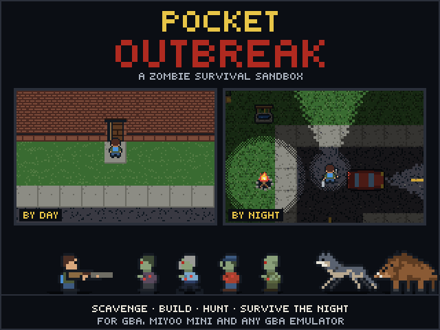
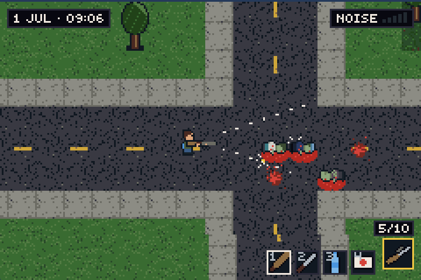
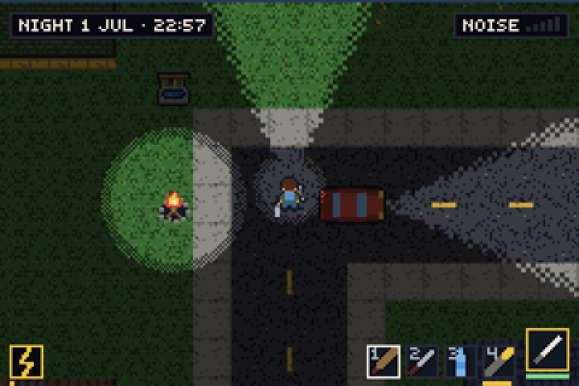
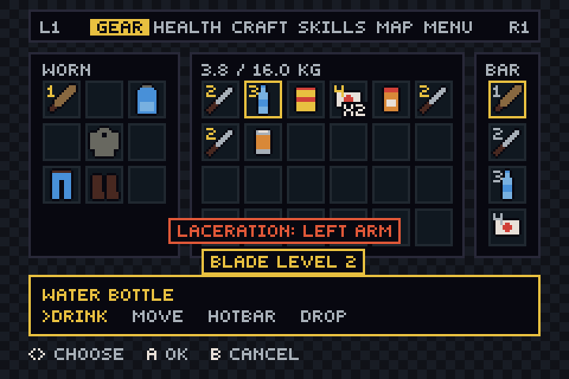
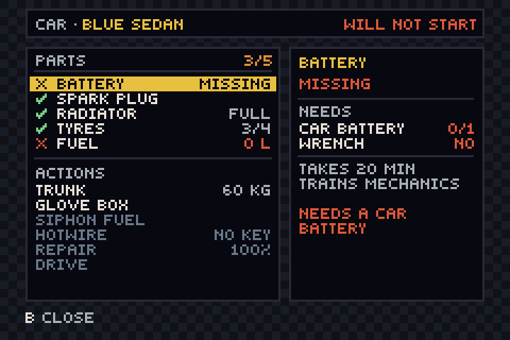
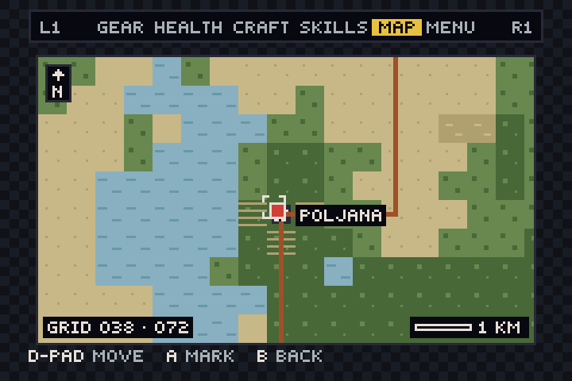
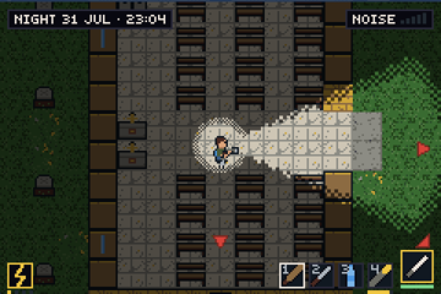
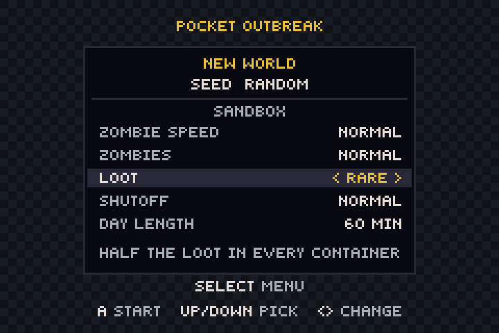
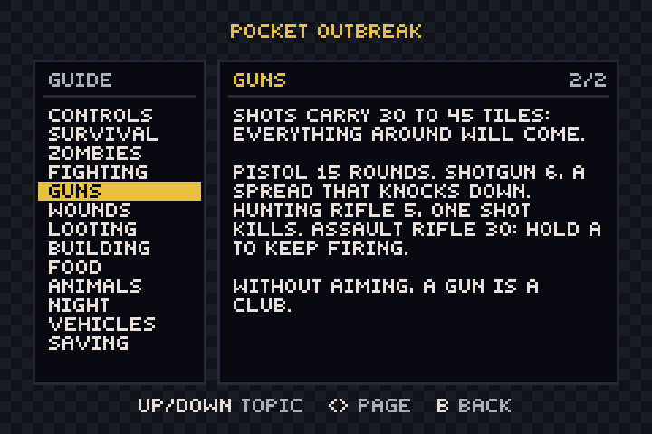

<div align="center">



# Pocket Outbreak

**A top-down zombie survival sandbox for the Game Boy Advance.**
Scavenge, build, hunt, and survive the night. There is no win condition: days survived is your score, and death is permanent.

[](https://github.com/altmihai31/pocket-outbreak/actions/workflows/build.yml)
[](LICENSE)


[Download the ROM](https://github.com/altmihai31/pocket-outbreak/releases/latest) · [How to play](#how-to-play) · [Build it yourself](#build-it-yourself)

</div>

---

## The game

Every world is generated from a seed, so each one has its own towns, villages, farms, forests, rivers and roads, and a calendar that keeps ticking. The water and the power go off in the first weeks, the seasons turn, and the hordes migrate hour by hour. You start as one survivor with an occupation and a few traits, and make it as far as you can.

Everything runs on real GBA hardware at a locked 60 fps. It's built with the [Butano](https://github.com/GValiente/butano) engine and tuned for the **Miyoo Mini / Mini Plus** (gpSP and mGBA cores). It plays the same in any GBA emulator.

<table>
  <tr>
    <td width="50%"></td>
    <td width="50%"></td>
  </tr>
  <tr>
    <td align="center"><sub><b>Fight</b> with bats, blades, spears and four guns, with aiming and active reloads.</sub></td>
    <td align="center"><sub><b>Survive the night.</b> Light carries, and so does noise.</sub></td>
  </tr>
  <tr>
    <td></td>
    <td></td>
  </tr>
  <tr>
    <td align="center"><sub><b>Scavenge</b> 200 items from houses, shops and set pieces.</sub></td>
    <td align="center"><sub><b>Get a car running:</b> a battery, fuel and a key, or hotwire it.</sub></td>
  </tr>
  <tr>
    <td></td>
    <td></td>
  </tr>
  <tr>
    <td align="center"><sub><b>Explore</b> a whole county. Find a map and mark what you see.</sub></td>
    <td align="center"><sub><b>A month in,</b> the grid is dead and a flashlight is all you have.</sub></td>
  </tr>
  <tr>
    <td></td>
    <td></td>
  </tr>
  <tr>
    <td align="center"><sub><b>Set the rules:</b> zombie speed, horde size, loot, shutoff and day length.</sub></td>
    <td align="center"><sub><b>A built-in guide</b> covers 13 topics, from controls to saving.</sub></td>
  </tr>
</table>

### What's in it

- **Survival:** hunger, thirst, sleep, body temperature, wounds, infection, stitching and bandages, and moodles that tell you what's wrong.
- **Zombies:** hordes counted per area that migrate by the hour and hunt by sight and sound. They break windows and barricades, and some crawl.
- **Combat:** melee with charge-up swings, shoves and stomps. Four guns with aiming, jams and active reload. Spears, bottles and Molotovs.
- **Base building:** barricades, crates, campfires, rain collectors, wooden doors, log walls and safehouses.
- **The wild:** foraging, farming, fishing, hunting deer, rabbits and birds, snares and traps, chopping trees, swimming, and wells.
- **Vehicles:** bicycles and cars with parts, keys, hotwiring, fuel, siphoning and alarms. Wrecks you can strip for parts.
- **A living world:** seasons, weather, the radio, the helicopter, power and water shutoffs, random events, and locked doors, safes and stashes.
- **Characters:** occupations, traits, 14 skills plus Fitness and Strength, and skill books.
- **Music and sound:** five original music loops with a director that follows the action, plus a full set of synthesized sound effects.
- **Saves:** an SRAM save with autosave and a record of past survivors. Death is permanent.

## How to play

1. Download `pocket-outbreak.gba` from the [latest release](https://github.com/altmihai31/pocket-outbreak/releases/latest).
2. Open it in any GBA emulator (mGBA is recommended), or copy it to your handheld.
   - **Miyoo Mini / Mini Plus (OnionOS):** put the ROM in `Roms/GBA/`. For box art, put `Pocket Outbreak.png` from the release in `Roms/GBA/Imgs/`, renamed to match the ROM's filename. It runs on both the gpSP and mGBA cores.
   - **Real hardware:** use any GBA flash cart with SRAM saves.

### Controls

| Button | In the world | In menus |
| --- | --- | --- |
| D-pad | Move. Double-tap and hold to jog. | Navigate |
| A | The action shown (`[A] SEARCH`, `[A] DRINK`…), otherwise swing. Hold to charge. | Confirm |
| B | Tap to shove. Hold while moving to sprint. | Back |
| L | Crouch | Previous tab |
| R (hold) | Aim a gun (A fires, B reloads) or a throwable | Next tab |
| Select | Use the chosen hotbar item. L + Select picks the next slot. | |
| Start | Open the menu tabs: Gear, Health, Craft, Skills, Map, Menu | Close |

To save and quit, open the **Menu** tab and hold A. The game also autosaves. The in-game **Guide** (Menu tab) explains everything else.

## Build it yourself

You need:

- [devkitPro](https://devkitpro.org/wiki/Getting_Started) with the **GBA Development** group (devkitARM, grit, gbafix, maxmod).
- Python 3 with Pillow (`pip install pillow`). The build draws all the art and synthesizes the sounds first.
- The Butano engine, which this repo includes as a git submodule.

```sh
git clone --recursive https://github.com/altmihai31/pocket-outbreak.git
cd pocket-outbreak/knox-gba
make -j
```

If you already cloned without `--recursive`, run `git submodule update --init` first, or the `butano/` folder will be empty.

The build writes `knox.gba`. On Windows, `.\build.ps1` runs the same build through devkitPro's MSYS2 shell. You can also build without installing anything, using Docker:

```sh
docker run --rm -v "$PWD":/src -w /src/knox-gba devkitpro/devkitarm \
  sh -c "apt-get update && apt-get install -y python3-pil && make -j PYTHON=python3"
```

The game's own [README](knox-gba/README.md) covers the profiler, debug and benchmark builds, the full controls and how the tools work.

## Repository layout

| Path | What's there |
| --- | --- |
| `knox-gba/src`, `knox-gba/include` | The game, in C++ on Butano |
| `knox-gba/tools` | Python generators for every sprite, tile, sound and music loop, plus mockup and debugging tools |
| `knox-gba/docs` | The design spec, milestone plans and playtest notes |
| `knox-gba/mockups` | The screen mockups the UI was built from |
| `butano/` | The Butano engine (git submodule) |

## Credits and license

Pocket Outbreak is by Mihai and released under the [MIT license](LICENSE). It's inspired by Project Zomboid, and all of its art, sound and music are original.

It's built on [Butano](https://github.com/GValiente/butano) by Gustavo Valiente (zlib license) and the [devkitPro](https://devkitpro.org) toolchain.
