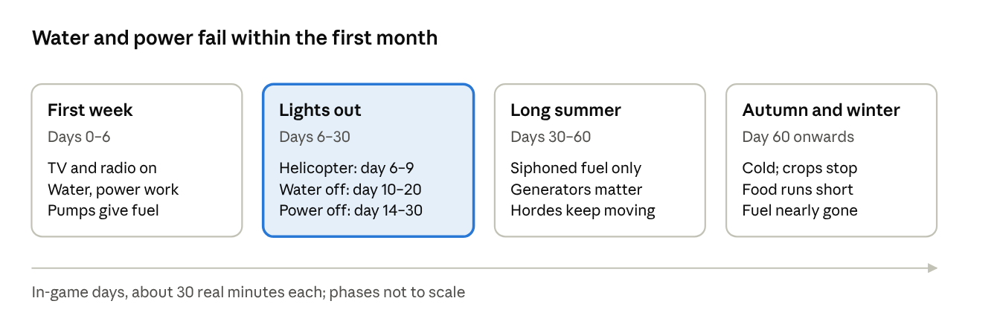

# Knox-style Survival for GBA — Design Spec

Nov 2, 2026 · @Mihai

## Pillars and scope

A single-player, top-down zombie survival sandbox in the spirit of Project Zomboid, built as a GBA ROM with Butano and tuned to run at a locked 60 fps on the Miyoo Mini (gpSP and mGBA). There is no win condition: days survived is the score, and death is permanent.

- **Mechanics first.** Every action responds within one frame, has layered feedback (sprite, sound, state change) and leads to a decision.
- **Simulation, not scripting.** Needs, wounds, noise, hordes and a decaying world interact; stories come out of systems.
- **Every fight is a risk.** A bite is almost always fatal, so avoiding combat is a valid skill.
- **The world decays.** Water and power shut off, broadcasts go silent, seasons turn; the early and late game play differently.
- **Fits the GBA by design.** Everything below is budgeted against GBA hardware, which the Miyoo emulates with plenty of headroom.

**View:** 3/4 top-down, 16 px tiles, 240×160 screen. It shows at 3× (720×480) on the Mini v4's 750×560 panel and at 2× on the Mini Plus's 640×480. Isometric was rejected for cost (see the cut list).

## Hardware budget

Everything in this spec fits with roughly half of main RAM and a third of the save left spare; CPU and background VRAM are the tight resources. Figures for Butano's own use are estimates to confirm with its profiler (`BN_PROFILER`) in the first milestone.

| Resource | GBA limit | Planned use | Headroom |
| --- | --- | --- | --- |
| CPU | 280,896 cycles per frame (16.78 MHz, 60 fps) | \~75% target at peak (see CPU split below) | \~25% |
| EWRAM | 256 KB | \~128 KB: engine \~40, chunk cache 27, world delta mirror 22, macro map + hordes 12, UI/text 8, flow field 8, entities 7, audio 4 | \~128 KB |
| IWRAM | 32 KB | engine + stack \~12 KB, hot ARM code (AI, collision, chunk gen) \~12 KB | \~8 KB |
| BG VRAM | 64 KB | 3 world maps × 8 KB (512×512 px wraparound) + HUD map 2 KB = 26 KB; tiles 38 KB ≈ 1,200 hardware tiles per biome | tight; one shared tileset per biome |
| OBJ VRAM | 32 KB | current animation frame per sprite, streamed by Butano | comfortable |
| Sprites (OAM) | 128, 32 affine matrices | \~81: player 2, zombies 40, particles 16, projectiles 8, animals 6, other 9 | \~47 |
| BG layers | 4 (mode 0) | BG0 HUD, BG1 roofs and canopies, BG2 walls and furniture, BG3 ground and decals | 0 |
| Palettes | 16 BG + 16 OBJ × 16 colours | 1 OBJ palette reserved all-white for hit flash | per biome |
| ROM | 32 MB | \~6 MB: graphics 2, audio 2, code 1, templates and data \~1 | \~26 MB |
| Save | 32 KB SRAM | \~22 KB (see Save system) | \~10 KB |

**CPU split at peak (targets):** zombie AI 25%, collision 10%, chunk generation 10% (spread across frames), audio mixing 10–15%, rendering and OAM updates 10%, BG streaming 5%, player and UI 5%. Hot loops go in IWRAM as ARM code (`BN_CODE_IWRAM`). All maths uses `bn::fixed` (12 fractional bits); no floats.

**Why SRAM, not Flash:** 32 KB SRAM is the save type gpSP and mGBA detect most reliably, so the save is designed to fit it.

**Text:** Butano's text generator draws with sprites, so gameplay HUD text goes on BG0 tiles; sprite text only in menus, where the game is paused and OAM is free.

**Miyoo specifics:** test every milestone on both gpSP (fast, less accurate) and mGBA. Avoid mid-scanline register tricks that gpSP may not emulate.

## World

A new 4,096×4,096-tile map (16 px tiles) is generated from a seed for every world: about 12 minutes to jog across, 4 by car. Only what the player changes is ever stored.

**Two layers**

1. **Macro map, built at world creation (< 1 s).** 64×64 cells, each covering 64×64 tiles. Each cell stores 2 bytes: terrain (forest, field, water, coast, hills), zone (town tier, farm, military, wilderness), a road mask and flags = 8 KB. A separate 1-byte horde count per cell = 4 KB. Towns are placed first, then roads connect them (minimum spanning tree plus a few extra links for loops).
2. **Detail chunks, built on demand.** A chunk is 32×32 tiles (512×512 px), generated from `hash(seed, chunk)` plus its macro cell: ground noise, trees, road tiles, and placed building templates. A 3×3 cache around the player (9 × 3 KB = 27 KB) gives a car enough warning. The same seed always produces the same chunk, so chunks are never saved.

**Towns and buildings**

- **30–40 hand-made building templates** in ROM (houses, flat block, garage, shop, petrol station, police station, clinic, school, barn, warehouse), each a small tile map with tagged containers, doors, windows and room types.
- **One hand-made set piece per town tier** (church, crashed bus, police barricade, military checkpoint), so towns are memorable and not just generated.
- **Roofs on BG1:** entering a building fades its roof out over 8 frames to reveal the interior.
- **Upstairs and basements** are separate small interior maps loaded at stairs (stretch goal).

**Streaming:** each world layer is a 256×256 px wraparound map of 32×32 cells (milestone 14; 512×512 before, which left no room for a 256-graphic tileset) (Butano's dynamic map cells). As the camera moves, one row or column of hardware tiles is written per frame; chunk generation is sliced across frames to stay inside its 10% CPU share.

**Density rule:** every screen-sized area (15×10 tiles) has at least one thing worth stopping for. Wilderness cells use scatter tables (hunter stands, wrecked cars, campsites, bodies) to meet it.

**Risk gradient:** the coast and small villages are safe but poor; inland towns, the military base and crash sites are dangerous and rich.

## Character

Each survivor starts from an occupation plus traits bought with points, then improves 14 skills by using them. A whole character is under 100 bytes of save.

**Occupations (10):** each gives starting skill levels and sometimes a perk.

| Occupation | Starting skills | Perk |
| --- | --- | --- |
| Mechanic | Mechanics 3 | Knows how to hotwire from the start |
| Carpenter | Carpentry 3, Short Blunt 1 |  |
| Nurse | First Aid 3 | Bandages last twice as long before going dirty |
| Police officer | Aiming 3, Reloading 2 |  |
| Fire officer | Axe 1, Fitness 1, Strength 1 |  |
| Chef | Cooking 3 | Recipes start known |
| Farmer | Farming 3 |  |
| Burglar | Sneaking 2, Lightfoot 2 | Hotwiring; picks locked doors quietly |
| Park ranger | Foraging 2, Carpentry 1 | Better in forests |
| Unemployed | none | +8 trait points |

**Traits (23: 22 in opposite pairs, and the Smoker alone; positive cost points, negative give them):** e.g. Strong, Athletic, Fast Learner, Keen Hearing (sounds heard 50% farther), Light Eater, Outdoorsman (rain and cold 50% less harmful), Eagle-eyed (a flashlight reaches 25% farther, dusk an hour later) (positive); Weak, Clumsy, Short-sighted (a flashlight reaches 25% less, dusk an hour sooner), Slow Healer, Cowardly, Hard of Hearing (no stereo cues, distant sounds lost), Homebody (rain and cold 50% more harmful), Smoker (+2: 8 in-game hours without a cigarette and unhappiness climbs, panic is held up; a cigarette takes 3 s with a lighter or matches) (negative).

**Skills (14), 5 levels each, levelled by doing:** Mechanics, Carpentry, First Aid, Cooking, Farming, Foraging, Sneaking, Lightfoot, Aiming, Reloading, plus four melee skills: Blunt, Blade, Axe, Spear. Levels unlock actions: hotwiring at Mechanics 2, sturdier barricades at Carpentry 3, stitching wounds at First Aid 2.

**Books:** skill books in 5 volumes (one per level band) multiply XP for that band by ×2 to ×5 once read. Reading takes in-game time and is only possible in light. Magazines teach single recipes (generator use, trapping, canning).

**Fitness and Strength** are body stats rather than skills: they rise slowly with exertion and set stamina pool, carry capacity and knockback.

## Health and survival

Needs and wounds are shown as status icons (moodles) that grow through 4 levels, not bars. All of them are integer counters updated once per in-game minute, not per frame.

**Needs and their moodles**

| Moodle | Driven by | At high levels |
| --- | --- | --- |
| Hungry / Thirsty | time, exertion, traits | slower healing, then health loss |
| Tired | hours awake | slower actions (Tired 2 and 3: searching, crafting, building, reading 25% and 50% longer), then forced sleep (Tired 4: 4 hours where you stand) |
| Exhausted (endurance) | sprinting, swinging, carrying | weaker, slower attacks; can't sprint |
| Wet | rain, swimming, sweat | speeds up Cold |
| Cold / Hot | weather, season, clothing insulation, wetness | health loss; colds |
| Panic | zombies in view, being grabbed | aim sway, slower actions |
| Morale | boredom + unhappiness + stress combined | slower XP (Unhappy 1-4: 90/75/60/50%); reading, radio, TV, good food, a cigarette (Smoker) restore it |
| Heavy load | carried kg vs Strength | slower movement, faster endurance drain |
| Pain / Bleeding / Sick | wounds, bad food, infection | see below |

At most 6 moodles show at once, in a row in the bottom-left corner of BG0, only while active; the worst sort to the left. Each change plays a short sound (stomach growl, shiver) so the player notices without looking.

**Body parts (6):** head, torso, left arm, right arm, left leg, right leg. Each stores 3 bytes: wound type, bandage state (none / clean / dirty) and a healing or infection timer.

| Wound | Cause | Treatment | Infection chance |
| --- | --- | --- | --- |
| Scratch | zombie swipe, broken glass | bandage | \~7% |
| Laceration | zombie swipe, blade | bandage, disinfect | \~25% |
| Deep wound | glass, gunshot | stitch (First Aid 2), bandage | high (regular infection) |
| Fracture | falls, car crash | splint | none; slows movement for weeks |
| Burn | fire | bandage | regular infection |
| Bite | zombie | none | \~100% zombie infection |

Zombie infection odds roughly follow Project Zomboid's defaults. Infection is invisible at first, then shows as Sick and Fever moodles over 2–3 in-game days before death. Regular wound infections are treatable with antibiotics or disinfectant.

**Food and water:** food has calories and spoils (see Save system for how spoilage is calculated). Tap water works until the water shutoff; afterwards water must come from rain collectors, wells or rivers and be boiled, or it causes Sick. Eating has a short animation and a visible meter refill.

**Visual cues:** dehydration and blood loss drain screen colour through palette fades; Panic adds a 1 px camera jitter.

## Zombies

Zombies exist at two levels: as head counts in macro cells everywhere, and as up to 40 individual sprites near the player. Hordes of hundreds are possible because only the nearest 40 are ever simulated in detail.

**Variation, PZ-style:** one zombie type with per-individual stats instead of special classes.

- **Speed:** \~80% shamblers, \~18% fast shamblers, \~2% sprinters (set per world in a sandbox screen: Shamblers has no sprinters and 10% fast ones, Fast 10% sprinters and 30% fast ones).
- **Crawlers:** a zombie whose legs are destroyed, or that is knocked down and not finished, keeps crawling. Easy to miss underfoot.
- **Toughness:** a hidden 1–3 health tier; some take one hit, some take five.
- **Outfit:** palette swaps by zone (police, soldier, doctor, farmer) also hint at loot carried.

**Senses and memory**

- **Hearing:** every action emits a noise event with a radius (footsteps 2 tiles, sprint 6, shove 4, breaking glass 12, gunshot 40, car alarm 60). Rain halves all radii.
- **Sight:** a 120° cone, 8 tiles in daylight and 3 at night; crouching in forest or long grass hides you beyond 2 tiles.
- **Memory:** a zombie that loses you searches your last known position for 20–60 s, then wanders.

**Behaviour states:** idle → wander → investigate noise → chase → attack (lunge with an 18-frame wind-up, or grab) → search. At obstacles: bang on doors, attack barricades, climb through open windows, smash closed ones (loud).

**Hordes and migration**

- Each macro cell holds a 1-byte head count. Every in-game hour, counts move one cell along the gradient towards recent loud noise and scripted events, so hordes drift across the map.
- Within 2 chunks of the player, counts materialise as individual zombies at plausible spots (indoors, behind cars); leaving the area turns them back into counts. Killed zombies reduce the count permanently.
- On screen, a horde larger than the 40-sprite pool is shown as its front rank plus off-screen noise and edge indicators.

**AI budget (25% CPU):** each zombie runs a full decision every 4th frame, staggered (10 per frame). Chasing zombies follow a shared flow field: a breadth-first fill over the 64×64 tiles around the player, recomputed 512 cells per frame (a full refresh every 8 frames, 8 KB). No per-zombie A\*.

## Combat

Melee is the core: committed swings, a shove to make space and a stomp to finish, with heavy game-feel on every hit. Guns win the fight in front of you and start the next one through noise. Frame counts are at 60 fps.

**Melee frame data**

| Weapon class | Wind-up / active / recovery (frames) | Damage | Endurance | Hitstop | Targets per swing | Notes |
| --- | --- | --- | --- | --- | --- | --- |
| Knife (Blade) | 4 / 3 / 10 | low | low | 3 | 1 | quiet; stealth kills |
| Bat, crowbar, pipe (Blunt) | 8 / 4 / 16 | medium | medium | 4 | 2 | widest arc, strong knockback |
| Axe (Axe) | 12 / 4 / 22 | high | high | 6 | 2 | charged hit kills outright |
| Spear (Spear) | 9 / 5 / 18 | medium | medium | 4 | 1 | longest reach (28 px) in a narrow 40° arc; two-handed; crafted from 2 sticks and a kitchen knife |
| Fists | 5 / 3 / 12 | very low | low | 2 | 1 | last resort |

- **Charged attack:** hold A to charge, release to swing; a visible pose shows full charge.
- **Shove (tap B):** no damage, 30-frame stagger, short cooldown, costs endurance. The main tool against groups.
- **Stomp:** press A over a downed zombie for a finisher.
- **Stealth kill:** crouched, from behind, with a blade: instant and quiet.
- **Grab:** a zombie that reaches you grabs you; mash A to break free. Each grab rolls a wound on an arm or the torso. A second zombie arriving during a grab is the main way players die.
- **Durability:** every hit wears the weapon; condition shows on the equipped icon. Duct tape, glue and a whetstone repair.

**Guns**

| Gun | Hands | Loaded | Range (tiles) | Damage | Noise radius (tiles) | Notes |
| --- | --- | --- | --- | --- | --- | --- |
| Pistol | one | 15 | 8 | 3 | 30 | common police loot; fast reload (48 frames) |
| Shotgun | two | 6 | 5 | 2 × 5 pellets, ±15° spread | 40 | knocks back everything hit; biggest hitstop and shake |
| Hunting rifle | two | 5 | 14 | 9 (kills any tier) | 45 | slow bolt (40 frames); farms and barns |
| Assault rifle | two | 30 | 10 | 3 | 45 | military zone only; ammo very rare; A held fires every 6 frames |

Built in milestone 12.6 (`docs/milestone-12.6-plan.md`); the numbers are tuning (the Guns debug page).

- **Aim:** hold R on foot. Movement drops to half speed; the aim follows the facing (8 directions) and swings to the nearest zombie within a 50° arc in front (soft auto-aim), bracketed in yellow. Each shot flies at a random angle inside a cone shown by two dotted lines: 20° each side while moving, narrowing to 8° after half a second standing still, 2° less per Aiming level, 4° more per Panic level. A shot hits the first zombie on its line; walls stop it. Shots are instant, with a 3-frame streak and muzzle flash. Without aiming, a gun is a club (the pistol hits like fists, long guns like a bat). Guns don't wear.
- **Active reload (mockup 11):** B while aiming starts a bar over your head with a green sweet spot (10 frames, somewhere between 35% and 70% of the bar). A in it loads at once; A outside it jams the gun ("JAMMED B CLEAR"; A only clicks) and B clears the jam in 30 frames. No press: it loads when the bar ends. Each Reloading level shortens the bar by 4 frames and widens the sweet spot by 2. Letting go of R drops a reload. The rounds loaded and the jam live in the gun item's extra field.
- **Throwables** (held in the secondary hand, thrown with R and A when the main hand holds no gun; up to 6 tiles in an arc, stopping short of walls):
  - Empty bottle: smashes, noise 12. Left over when a water bottle or soda is finished.
  - Alarm clock: rings 20 s, noise 10 every 2 s, then lies where it fell.
  - Molotov (crafted: bottle, rag, 1 l of fuel): smashes and sets a 3×3 patch burning for 15 s. Zombies in it lose 1 health every half second and burn 3 s more after leaving, without staggering; the survivor gets a Burn on a leg on stepping in and each second after. It lights the night like a campfire. Fires and ringing clocks end when time is skipped (sleep, cooking, reading) and are not saved.

**Game feel on every hit:** hitstop (simulation paused, rendering running), 2-frame white flash via the reserved OBJ palette, 1–3 px BG scroll shake scaled by weapon weight, knockback with friction, layered impact plus groan sounds with ±10% random pitch. Blood splats and corpses are written into BG3 as decals, so they cost no sprites.

## Movement, camera and exploration

Movement reaches top speed in 4–6 frames and stops in 3–4, in 8 directions, with sub-pixel positions in `bn::fixed`. Every speed below is a tuning value in one data table.

| Mode | Speed (px/frame) | Noise radius (tiles) | Cost |
| --- | --- | --- | --- |
| Crouch | 0.6 | 1 | slow |
| Walk (default) | 1.0 | 2 | – |
| Jog | 1.5 | 4 | slight endurance |
| Sprint | 2.25 | 6 | endurance, thirst |
| Bicycle | 2.5 | 2 | needs roads or paths |
| Car | up to 4.5 | 15 (engine) | fuel, see Vehicles |

- **Diagonals** are multiplied by 0.7071 so they aren't 41% faster.
- **Corner sliding:** hitting a corner with up to 4 px of overlap into an opening nudges the player through.
- **Terrain:** road full speed; grass full; forest and mud −20% speed but hide you; shallow water −40% and loud; deep water is swimming (half walking speed, endurance drain like sprinting, soaks you; no attacks, aiming or items; Exhausted 4 drowns you a point of health a second; not with Heavy load 2; never more than 8 tiles from land). Zombies, cars and bicycles never enter deep water.
- **Footsteps** per terrain, timed to walk-cycle frames; occasional dust and splash sprites; 1 px walk bob; animation speed tied to actual velocity.
- **Fall-over:** sprinting into obstacles or tripping over a crawler knocks you down for 40 frames.

**Camera**

- 24–32 px lookahead in the direction of movement, eased at 1/8 of the gap per frame; widens with vehicle speed up to 80 px.
- 16 px deadzone so small corrections don't move the screen.
- Aiming shifts the camera further towards the aim direction (24 px, eased over 12 frames).

**Exploration**

- **Rhythm:** a small reward every 10–20 s of walking; a big one (new town, crash site, stash) every few minutes.
- **Beyond the screen:** distant gunshots, helicopters and alarms panned in stereo; smoke columns drawn as tall sprites cut off at the screen edge; edge arrows for discovered landmarks.
- **Map and compass are items.** Without a map there is no map screen; without a compass, no position marker on it. Fog of war clears as you walk (128×128 bitset, one bit per 32×32-tile chunk: the chunk you are in and the 8 around it). The Map tab (mockup 05) shows 15 macro cells across at 12 px, names the settlements you have visited (from 24 names picked by the seed), shows safehouses, and takes up to 8 marks set with A on a chunk cursor. With a compass it opens on you, and an arrow at the screen edge points to the nearest mark. Map, marks and what is explored belong to the world, so a new survivor keeps them.
- **Hooks:** locked doors (key from a specific house, crowbar, or lockpicking), notes naming places, a working car that needs one part, a gun safe that needs a code found elsewhere. Built in milestone 12.7 (`docs/milestone-12.7-plan.md`):
  - **Doors:** every one-tile doorway of a house, the police station and the clinic has a door; A opens and closes it (also with zombies about, not on anyone in the doorway). Closed, it blocks movement, sight, shots and throws; zombies bang on it and break it in 12 hits.
  - **Locks:** a third of houses have their front door locked (from the seed). Its key or the latch from inside opens it quietly; a crowbar in hand forces it in 2 s (loud, the door breaks); a screwdriver picks it in 5 s with a 40% chance to slip (8% less per Sneaking level); the Burglar picks in 2 s, silently, never slipping.
  - **Keys** belong to a locked house in the town they are found in; taking one marks the house on the Map tab.
  - **Notes** (READ in the Gear tab) give a gun safe's code, tell of a town's stash (a bag put out in the woods when it is read), or are letters naming a place. **Gun safes** (every police station, a fifth of houses) open only with their 3-digit code on a dial screen; codes come from the seed.
  - **Automatic marks:** up to 16 on the Map tab (a key's house, a note's safe or stash), apart from the player's 8.
- **Foraging:** search mode in forests and fields finds berries, mushrooms (some poisonous), sticks, stones and herbs; Foraging skill widens the radius.

## Looting, items and inventory

About 200 item types live in one ROM table; containers are rolled the first time they are opened, so unopened ones cost nothing in RAM or save.

**Item record (ROM, 12 bytes):** id, category, weight (0.1 kg units), stack size, max durability, nutrition or effect value, flags (edible, spoils, tool, fuel, clothing slot), icon id, loot rarity.

**Item instance (RAM/save, 4 bytes):** type id (1 byte), condition or quantity (1 byte), extra state such as freshness day or ammo loaded (2 bytes).

| Category | Approx. types | Examples |
| --- | --- | --- |
| Food and drink | 45 | canned beans, tuna, chips, raw meat, fish, berries, pop, water bottle |
| Medical | 15 | bandage, rag, disinfectant, antibiotics, painkillers, splint, suture needle |
| Melee weapons | 20 | kitchen knife, hunting knife, bat, crowbar, pipe, hammer, axe, machete, spear |
| Firearms and ammo | 10 | pistol, shotgun, hunting rifle, assault rifle, 4 ammo types |
| Tools and materials | 40 | hammer, saw, screwdriver, wrench, nails, planks, logs, duct tape, glue, rope |
| Clothing and bags | 35 | jackets, raincoat, boots, gloves, hat, school bag, hiking bag, military backpack |
| Car parts and fuel | 10 | battery, spark plug, radiator, tyre, jerrycan, siphon hose |
| Farming and cooking | 15 | seed packets, watering can, shovel, cooking pot, frying pan, matches, lighter |
| Books and misc | 15 | skill books, magazines, map, compass, flashlight, battery, radio, key |

Milestone 14 brought the table to 200 types (`include/kx_items.h`). The loot census (bench 14, `tools/census_report.py`) checks the tables against written targets: a house's kitchen about a day and a half of food, a loose gun in about 25 homes, ammunition more often, the military base 0.5-1.5 guns a building.

**Containers and loot tables**

- Each template container is tagged with a room type (kitchen, bathroom, bedroom, garage, shop shelf, police locker, fridge, car trunk, zombie corpse) that picks its loot table.
- Roll on first open with `hash(seed, chunk, container index)`: 0–8 items, weighted by rarity, multiplied by the zone tier (military ×3 weapons and ammunition, village ×0.8, town ×1, big town ×1.2, wilderness and coast ×0.5 everything) and by the sandbox's loot setting (×0.5 / ×1 / ×1.5).
- Opening a container sets its opened bit; items taken or left are written to the world delta list.
- House keys map to a specific house id, so a key found on a zombie points somewhere.

**Search feel:** a progress bar while searching; items appear one at a time with a pop; rare items get a distinct chime and a 1-frame flash.

**Inventory:** weight-based, PZ-style. Carry capacity = 8 kg + Strength bonus + equipped bag (school bag +8, hiking bag +14, military backpack +18). Above capacity you get Heavy load. Equipped slots: primary hand, secondary hand (a flashlight or a throwable next to a one-handed weapon; two-handed weapons empty it), back (bag), and 6 clothing slots (head, torso, jacket, legs, feet, hands) each with insulation, wetness and protection against scratches and bites. A worn leather jacket can turn a bite into a scratch.

**Hotbar:** 4 quick slots that point at anything carried, for weapon swaps, bandage, food, flashlight (the belt was cut, see the cut list).

## Base building, farming and cooking

You fortify existing buildings rather than build from nothing. Up to 3 safehouses with 64 placed pieces each; every piece is a background tile plus a 4-byte record, so a full base costs no sprites.

**Building (Carpentry)**

| Piece | Materials | Carpentry | Notes |
| --- | --- | --- | --- |
| Barricade window or door | 3 planks, 6 nails, hammer | 0 (3 for reinforced) | health 100, reinforced 250; zombies target the weakest |
| Wooden crate | 4 planks, 8 nails | 1 | 40 kg storage |
| Log wall | 4 logs, 6 nails | 2 | blocks paths, fences gardens; outdoors; health 150; logs from chopping trees with the axe (4 s, loud, a stump left, 2 logs) |
| Wooden door | 4 planks, hinge, doorknob | 3 | in an empty or broken doorway; opens and closes, never locked against you; health 200 |
| Rain collector | 4 planks, 4 nails, garbage bag | 2 | fills in rain; needs boiling |
| Campfire | stones, sticks, matches | 0 | light, warmth, cooking, drying; visible at night |
| Bed (moved, not built) | – | – | sleep, skip night, autosave |

- Hammering is loud (noise radius 12): clear the area first.
- Zombies that reach a base attack the weakest barricade; returning to a damaged base is a reason to scavenge for nails and planks.

**Farming:** plough a plot with a shovel, plant seeds, water it. Crops grow through 4 stages over 10–30 in-game days; rain waters them; neglected plots rot; winter stops growth. 32 plots per world, 4 bytes each (crop, plant day, last watered day, state).

**Cooking:** about 15 recipes combining a base (water, pot) with ingredients (stew, soup, roasted meat, fried fish, boiled water). Cooking needs a heat source: campfire, a stove while the power is on, or a gas stove with a propane tank. Cooked food restores more and lifts Morale; raw meat risks Sick.

**Power and preservation:** fridges slow spoilage only while powered; chest freezers (some kitchens, shops and petrol stations) stop it while powered, by the grid or a generator nearby. After the power shutoff, a generator (rare, heavy, fuel 1 l per \~3 in-game hours, noise radius 20) powers appliances and lights within 10 tiles. Up to 4 generators per world. Canning (magazine plus jars) preserves food without power.

**Traps:** snare and box traps placed in forests catch small game overnight (Foraging skill): a snare (rope and a plank) catches rabbits, a box trap rabbits or birds; bottle-can alarm lines at a base make noise when crossed.

**Hunting** (milestone 13): deer graze in wild and farm areas and flee from the survivor (8 tiles, 3 crouched) and from loud noise; rabbits sit about by day; flocks of birds take off with a flutter (a noise of their own) when anyone comes near. Deer are shot (2 rifle or shotgun hits, 3 pistol) or stalked and struck; a carcass is butchered with a knife or an axe into 4 raw meat and a hide (2 rope by hand). Live animals are not saved; a cell where a deer was killed has none for 7 days.

**Water:** wells (every farm, half the villages) give water any time, power or not; like rain water it is unboiled (a small chance of Sick).

## Vehicles

Cars are everywhere but about 90% are wrecks; a working one is a mid-game project. A bicycle comes first.

**Bicycle:** found in garages and sheds. 2.5 px/frame, quiet, no fuel, fast on roads and paths, poor off-road; you fall off if you hit a zombie.

**Cars**

- **Wrecks** are containers (trunk, glove box) and cover, and they block roads. Opening one can set off its alarm (noise radius 60).
- **A working car needs 5 parts**, shown as a ✓/✗ checklist: battery, spark plug, radiator filled with water, at least 3 good tyres, fuel. Parts come from other wrecks, garages, petrol stations and farms.
- **Starting it:** the key (found in a specific house or on a zombie) or hotwiring (Mechanics 2, or the Mechanic or Burglar occupation), which takes time, makes noise and can fail.
- **Fuel:** petrol pumps work until the power shutoff; afterwards siphon from other cars with a hose. Jerrycans carry 10 l.
- **Driving:** engine noise radius 15, headlights drain the battery when the engine is off, the trunk is mobile storage (60 kg).
- **Besieged:** zombies that reach a car you sit in hit it (noise radius 6, 2 of its 100 condition each); below 25 they drag you out.
- **Hitting zombies:** a thump with hitstop and shake; it damages the car and slows it. Ploughing into a crowd can stall or wreck it.
- **Crashes** damage the car and can cause fractures or deep wounds.

**Technical**

- Physics: heading in 32 steps with sine and cosine lookup tables; velocity along the heading; a lateral-friction factor gives grip or drift; tile collisions bounce and damage. Top speed 4.5 px/frame on road, about half off-road.
- Sprite: 32×32, drawn in 16 directions (9 drawn, the rest mirrored), not hardware-rotated, so it uses no affine matrix.
- Streaming at 4.5 px/frame crosses a chunk every \~2 s; the 3×3 chunk cache and sliced generation keep up.
- Save: up to 24 tracked cars (moved, repaired or looted) at 16 bytes each; untouched wrecks are regenerated from the seed.

## World timeline and events

The world starts on 1 July with everything working and decays on dates rolled per world from the seed, so no two runs fail in the same order.

The shutoff days are random within each window (the sandbox's shutoff setting picks the windows: week 1, the ones above, month 2 or never; the setting is kept in the save header and the days rolled from the seed); the player only learns them when the tap runs dry or the lights go out.

- **Broadcasts:** TV and radio give survival tips, lore and an emergency channel through the first week, then go silent one by one. Text only, with a static sound. TVs (some living rooms) need power and have a few broadcasts of their own.
- **Helicopter event (day 6–9):** flies over the player's area and drags every horde along its path.
- **Random events:** distant gunshots, house and car alarms, and rare crash sites with military loot and a smoke column visible from far away. Each one creates a noise event that moves hordes.
- **Weather:** rain, fog and storms derived from `hash(seed, day)`. Rain soaks you, halves noise radii and waters crops; fog cuts sight radius via alpha blending.
- **Seasons:** temperature falls from day \~60; from day \~150 it is winter, crops stop and cold becomes the main threat.

## Night and light

Night is drawn with the hardware's fade to black and its windows, so it costs almost nothing per frame (milestone 12.5).

- **Darkness:** from 19:00 the world layers and the world's sprites fade towards black, a step at a time, to 10 of 16 steps at 20:00; dawn takes them back between 06:00 and 07:00. The HUD stays bright. Fog at night adds 2 steps instead of its white haze.
- **Roofs at night:** the roof of the building you are in is not drawn at all (instead of fading), so the light windows below work indoors.
- **Light windows:** window sprites and one rectangle switch the fade off where they are, so what they light is seen at full brightness.
  - A flashlight's beam (a 64×64 frame at double size, turned by the hardware) about 128 px ahead along your facing, with a small glow around you.
  - The same beam from a car's headlights.
  - A round glow 4 tiles across on a burning campfire, or on a Molotov's fire (milestone 12.6).
  - The whole building you are in, while the grid has power or a running generator is within 10 tiles.
  - Light passes through walls: window sprites can't cast shadows.
- **Flashlight:** switched on and off from the hotbar. A battery lasts 6 in-game hours; then it needs a new Battery. It switches itself off at dawn and goes dark while you drive. Its state lives in the item (on, charge), so it is saved with it.
- **Night rules:**
  - A lit player (flashlight, headlights, by a campfire or a fire, in a lit building) is seen from 6 tiles instead of 3.
  - A burning campfire heats its macro cell each night hour as a 12-tile noise would, so hordes come to it.
  - Reading needs a light that is on; reading stops if it goes out.

## Save system and lazy simulation

The save holds the seed plus everything the player changed, about 22 KB of the 32 KB SRAM. Nothing ticks per frame unless it is on screen: timed things store when they started and are worked out when looked at.

**Lazy simulation**

- **Food freshness** = now − spawn day, slowed for the days its fridge had power (known from the shutoff day).
- **Crops** = stage from plant day and last-watered day, with rain days from the weather seed.
- **Barricades** = health minus damage from horde passes since the last visit, rolled on approach.
- **Generators** = fuel minus hours elapsed since last refill.
- **Weather** = derived from `hash(seed, day)`, so past and future weather never need storing.

**Save layout (SRAM, 32 KB)**

| Block | Size | Contents |
| --- | --- | --- |
| Header | 64 B | magic, version, seed, sandbox settings, world day and time, CRC |
| Character | 1 KB | stats, skills and XP, traits, body parts, moodle counters, inventory and worn items |
| Touched chunks | \~4.8 KB | \~600 entries × 8 B: chunk index, opened-container bitmask, offset into the item list |
| World items | 8 KB | up to 2,000 dropped or stored items × 4 B |
| Horde counts | 4 KB | 1 B per macro cell |
| Fog of war and map marks | 2 KB | 128×128 bitset, 8 marks |
| Base pieces | 768 B | 3 safehouses × 64 × 4 B |
| Cars | 384 B | 24 × 16 B |
| Farm plots | 128 B | 32 × 4 B |
| Past survivors | 256 B | 4 dead characters: position and inventory reference |
| Timeline and events | 64 B | shutoff days, event flags, broadcasts heard |
| Total | \~21.5 KB | \~10 KB spare |

**Saving:** autosave on sleeping and on quitting from the menu, plus every in-game hour while walking. One world slot with a CRC that detects a cut-off write. The header and character block (about 1 KB) are double-buffered in the spare space, so a failed save loses at most the world changes since the last one, never the character. Caps (items, chunks, pieces) show in the UI when close to full (the pause menu's save line shows `WORLD n%` above 80%, a toast warns once at 90%).

**Permadeath:** on death the character block is cleared and the world stays. A new survivor starts in a random low-tier town; the dead one is placed as a zombie carrying their gear.

## Controls and UI

Only the GBA's 10 buttons are used, so the ROM plays the same on the Miyoo, a phone emulator or real hardware. Every press gets a response the next frame, even when the action is blocked (an empty gun clicks, a full bag flashes: the carried weight blinks red on the search screen).

| Button | In the world | In menus |
| --- | --- | --- |
| D-pad | move (8 directions) | navigate |
| A | context action: attack (hold to charge), search, open, pick up, stomp | confirm |
| B | tap: shove; hold while moving: sprint | back |
| R | hold: aim a gun (A fires, B reloads) or, with no gun in hand, a throwable in the secondary hand (A throws) | next tab |
| L | toggle crouch | previous tab |
| Select | use the selected hotbar item | – |
| L + Select | cycle hotbar slot | – |
| Start | open menu (pauses) | close |

**HUD (BG0 tiles, no sprites):** time and day top-left, noise meter top-right, moodle row bottom-left (only while something is wrong), equipped item with condition and hotbar bottom-right, context prompt above the target.

**Menu tabs (L/R to switch):** Gear (inventory, worn, bag), Health (body diagram, wounds, moodles explained), Craft (recipes filtered to what you can make now), Skills (levels, XP, books read), Map (overview, fog, marks; needs a map item).

**Other screens:** world creation (seed, sandbox settings: zombie speed, zombies, loot, shutoff, day length; shown read-only in the Map tab's margin), character creation (occupation, traits, points), container overlay, sleep (hours to sleep), death screen ("This is how you died": days survived, kills, distance walked, cause).

**Font:** an 8×8 pixel font on BG0; 16 px lines at 2× for headings. All text in one ROM string table, ready for translation.

## Cut list

These are left out because the GBA can't do them, or because their cost would starve the core systems.

| Feature | Why it's cut | What replaces it |
| --- | --- | --- |
| Isometric view | depth sorting, diagonal collision, roughly double the art | 3/4 top-down with roof cutaway |
| Multiplayer | no network; GBA link cable irrelevant on Miyoo; RetroArch netplay unreliable | past survivors as zombies in the same world |
| More than 40 individual zombies | 128 sprites and AI CPU budget | abstract hordes that materialise near the player |
| Computer-controlled survivors | pathfinding, combat AI and inventory per NPC | broadcasts, notes, signs of other survivors (stretch: static raider camps) |
| Real lighting and shadows | no per-pixel lighting | OBJ-window flashlight cone, brightness fade, palette fades |
| Per-part car condition | unreadable on 240×160, extra save | 5-part ✓/✗ checklist |
| Thousands of items | inventory and loot-table readability | \~200 types |
| Destructible walls | map is regenerated from the seed | doors, windows and barricades break |
| Paper-doll clothing layers | one sprite per layer would eat OAM | clothing shown through palette swaps |
| Voiced radio and TV | ROM and audio channels | text broadcasts with a static sound |
| Real-time clock | not reliably emulated in gpSP | in-game clock only |
| Belt (2 quick items) | the hotbar already reaches anything carried | the 4-slot hotbar |

**Stretch goals** if budgets allow after milestone 12: upstairs and basement interiors, raider camps, fishing mini-game, snow-season palette and footprints.

## Build order

Build the feel first and the content last: milestones 1–2 decide whether the game is fun, so nothing else starts until they feel right on the Miyoo. Every milestone ends with a ROM tested on the device under both gpSP and mGBA, with the CPU profiler inside its budget.

**Feel**

1. **Movement and camera:** player, 8-way movement, corner sliding, terrain, lookahead camera, one hand-made test map. Tuning table live in a debug menu.
2. **Combat slice:** walker zombies with telegraphed lunges and grabs; knife, bat, axe; shove, stomp, charge; hitstop, flash, shake, knockback, sounds.

**Core loop**

3. **Looting and inventory:** item table, containers with lazy rolls, search reveal, weight, bags, worn clothing, hotbar.
4. **Survival simulation:** needs, moodles, body parts and wounds, infection, food and water, sleep.
5. **World generation:** macro map, chunk streaming, building templates, roofs, towns and roads from a seed.
6. **Zombie simulation:** senses, noise events, flow field, hordes as counts, materialising and migration.
7. **Save system:** world delta, SRAM layout, autosave, permadeath and past survivors.

**Depth**

8. **Character:** occupations, traits, 14 skills, books.
9. **Base building:** barricades, crates, rain collector, campfire, zombies attacking barricades.
10. **World timeline:** water and power shutoff, broadcasts, helicopter and random events, weather, seasons.
11. **Farming, cooking, generators, traps, foraging.**
12. **Vehicles:** bicycle, then cars with parts, keys, hotwiring, fuel and alarms.

**Catch-up**

An audit on 10 Nov 2026, after milestone 12, found systems that this spec describes but that no milestone above names. They are built here, before the finish. `docs/milestone-12.5-plan.md` has the full audit.

- **12.5 Night, map and loose ends (built 10 Nov 2026):** night darkness with dusk and dawn; the flashlight cone and its batteries; campfire, headlight and indoor light; light giving you away to zombies. The Map tab with fog of war, compass and marks. Stitching deep wounds, weapon repair, the remaining traits, zombies attacking a car you sit in.
- **12.6 Ranged combat (built 19 Nov 2026):** pistol, shotgun, hunting rifle and assault rifle; ammo, aiming and active reload; spears; throwables, Molotovs, fire tiles and burns; the secondary-hand slot (the belt was cut).
- **12.7 Doors and hooks (built 20 Nov 2026, `docs/milestone-12.7-plan.md`):** doors that open, lock and break, with zombies banging on them; house keys, crowbar and lockpicking; the wooden door and log wall pieces, and chopping trees for logs; notes naming places, stashes; gun safes with codes.

**Finish**

13. **The wild and loose ends (built; `docs/milestone-13-plan.md`, with the full audit of what was unbuilt):** swimming in deep water; deer, rabbits and birds, hunting and butchering; snares, freezers and wells; sandbox settings on world creation; the Smoker trait, cigarettes and the lighter; Tired and Unhappy effects, forced sleep, the aim camera, the full-bag flash, save caps in the UI, zone-tier loot, TV broadcasts.
14. **Content and polish (built, `docs/milestone-14-plan.md`):** room for 256 world graphics (smaller wraparound maps instead of a second bank), fill out to \~200 items and 30–40 templates, set pieces per town tier, wilderness scatter (hunter stands, campsites), music (4–5 moody loops on the old sound channels) and a sound pass, balancing, then stretch goals if budgets allow.
